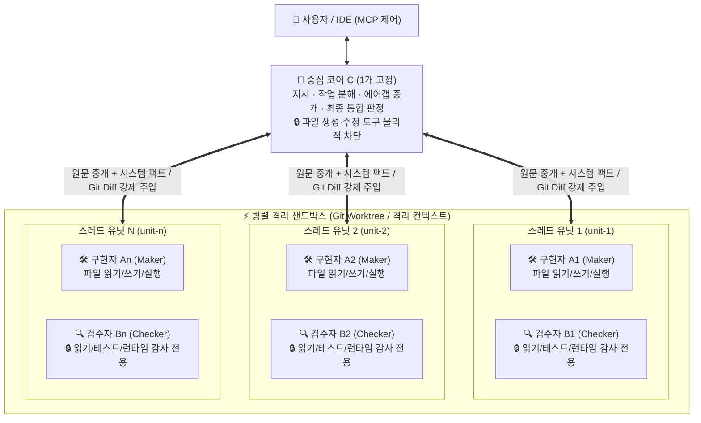

# 🧠 `CKD` 이론 (Air-Gapped Triadic Verification & Closed-Loop Knowledge Distillation)

  <strong>환각(Hallucination) 없는 AI 시스템과 자가 검증형 소형 AI(SLM)를 위한 물리적 삼권분립 · 에어갭 원문 중개 · 3자 만장일치 수렴 이론</strong> 
  <em>창안 및 설계 (Originated & Architected by): <a href="https://axnli.com">주식회사 에이엑스엔엘아이 (AXNli Inc.)</a> (Systems for Data & AI)</em>

  
  
  
  

---

> 🌐 **For the English edition of this whitepaper, please see [README.md](./README.md).**

---

## 1. 먼저 짚고 넘어갈 핵심 차이점 & 기존 에이전트의 한계

> [!IMPORTANT]
> **오해 방지: 클로드(Claude)·제미나이(Gemini)의 '프로젝트 내 멀티 채팅 스레드' 방식이 아닙니다!**
> * 클로드 프로젝트나 제미나이·챗GPT에서 스레드를 여러 개 여는 것은 **사람이 직접 여러 대화방을 오가며 각각 다른 대화를 나누는 사용자 관리형 멀티 채팅**입니다.
> * 반면 **`CKD` 이론**에서 사용자는 **오직 단 1개의 중심 코어(`C`)에게 한 번만 목표를 말하며**, `C`가 그 **하나의 목표를 완수하기 위해 시스템 내부에서** 구현자(`A_n`)와 전담 검수자(`B_n`) 페어(`[A1·B1], [A2·B2]...`)를 자동 분화시켜 교차검증 후 하나로 병합하는 **단일 목표 완수형 3권분립 아키텍처**입니다.

현재 시장의 AI 에이전트들은 크게 두 가지 방식으로 나뉘며, 두 방식 모두 구조적인 인식론적 한계(Epistemic Bottleneck)를 안고 있습니다:

1. **단일 에이전트 하네스의 한계 (*SWE-agent, Aider, 일반 IDE 에이전트 루프*)**
   * 하나의 세션(컨텍스트 창) 안에서 AI가 혼자 계획하고, 코드를 고치고, 테스트를 돌려보고, 스스로 완료 여부를 판단합니다 (`Plan -> Edit -> Run -> Self-Check`).
   * **구조적 결함 1 (자기 확증 편향 / Self-Confirmation Bias)**: 버그를 만든 바로 그 확률 분포(세션)가 검수까지 맡기 때문에, 실패 원인을 합리화하거나 테스트 조건을 느슨하게 바꿔치기하고 "완료되었다"고 환각(Hallucination)을 일으킵니다.
   * **구조적 결함 2 (컨텍스트 오염 / Context Pollution)**: 시행착오와 에러 로그가 한 세션에 누적될수록 초기 요구사항과 엣지 케이스에 대한 주의력(Attention)이 급격히 떨어집니다.

2. **대화방형 멀티에이전트의 한계 (*AutoGen, CrewAI 등 역할극 스웜*)**
   * "개발자", "리뷰어", "기획자" 프롬프트만 다르게 준 여러 에이전트가 하나의 공유 대화방에서 직접 대화를 나눕니다.
   * **구조적 결함 (집단 동조 환각 / Sycophantic Groupthink)**: 개발자 AI가 그럴듯한 말로 "수정 완료했다"고 주장하면, 같은 대화 맥락을 공유하는 리뷰어 AI가 직접 검증하지 않고 맞장구를 치며 통과시키는 현상이 발생합니다.

---

## 2. 패러다임 비교: 일반 에이전트 하네스 vs 대화방 멀티에이전트 vs `CKD` 이론

**[주식회사 에이엑스엔엘아이 (`AXNli Inc.`)](https://axnli.com)**가 창안한 **`CKD` 이론**은 단순한 프롬프트 역할극이 아니라, **물리적 삼권분립(도구 권한 박탈)**, **에어갭(Air-Gap) 원문 중개**, 그리고 **3자 만장일치(`A · B · C`) 수렴 루프**를 강제하는 AI 시스템 공학 이론입니다.

| 비교 항목 | 단일 에이전트 하네스 (`SWE-agent` 등) | 대화방형 멀티에이전트 (`AutoGen`, `CrewAI`) | **⚡ `CKD` 이론 by AXNli Inc.** |
| :--- | :--- | :--- | :--- |
| **역할 위상 구조** | 에이전트 1명이 전부 수행 | N명의 에이전트가 한 방에서 직접 대화 | **`1개 고정 중심 코어(C)` + `N개 병렬 [A_n · B_n] 세트`** |
| **소통 및 격리 규칙** | 단일 컨텍스트 자문자답 | 작업자와 리뷰어가 직접 대화 (`A <-> B`) | **절대 에어갭(Air-Gap)**: `A_n`과 `B_n`은 직접 대화 불가 · 오직 `C`가 중개 |
| **도구 권한 분리** | 모든 권한 독점 | 프롬프트로만 제한 ("수정하지 마세요") | **런타임 물리적 권한 박탈**: `B_n`과 `C`는 파일 쓰기/수정 도구 자체가 제거됨 |
| **증거 전달 방식** | 에이전트 본인의 요약 보고 | 대화방에 텍스트로 주장 전달 | **시스템 사실 강제 주입**: `C`가 `A_n`의 `git diff` 및 시스템 팩트를 자동 추출해 `B_n`에게 강제 첨부 |
| **`1회차 (1 Round)` 정의** | 도구 1회 호출 또는 단순 재시도 | 대화 1턴 | **`[A_n ⇄ B_n 둘 다 완료 선언할 때까지 내부 핑퐁]` + `[C의 전체 통합 확인]`** |
| **최종 완성 조건** | 에이전트 단독 "완료" 선언 | 리뷰어의 단순 "통과" 응답 | **`A(DONE) + B(DONE) + C(PASS)` 3자 만장일치 완료 선언** (`무한 반복(0)` 또는 `N회`) |
| **작업 종료 후 산출물** | 버려지는 일회성 로그 | 버려지는 채팅 기록 | **인간 판정 잠금(`training_label`) 기반 역할별 재학습 데이터셋 (`A.jsonl`, `B.jsonl`, `C.jsonl`, `curated.jsonl`)** |

---

## 3. `CKD` 이론의 4대 핵심 공리 (Formal Axioms)

### 공리 1: 물리적 삼권분립 (`C ≠ A ≠ B`)

CKD는 에이전트의 권한을 입법·사법(`C`), 행정·구현(`A`), 독립 감사(`B`)의 3가지 배타적 권한으로 물리적으로 분리합니다.

* **`C` (1개 고정 중심 코어)**: 사용자와 대화하는 유일한 주체입니다. 사용자의 자연어 요청을 분석하여 분업(`split`) 또는 경쟁(`compete`) 방식과 `[A_n·B_n]` 세트 수를 결정하고, `A_n`과 `B_n` 사이에서 시스템 팩트를 가감 없이 원문 중개하며, 모든 유닛 완료 후 최종 통합 판정(`PASS` / `FAIL`)을 내립니다. `C`는 직접 파일을 수정할 수 없도록 도구가 물리적으로 차단되어 있습니다.
* **`A1..An` (구현 전담 스레드)**: 격리된 작업 공간에서 배정받은 단위 과제의 구현과 수정에만 집중합니다.
* **`B1..Bn` (1:1 전담 검수 스레드)**: `A1..An`과 1:1 짝꿍으로 묶여 있으며, 파일 수정 도구가 물리적으로 차단된 상태에서 시스템이 강제 추출한 팩트(`git diff`, 테스트 결과, API 응답 등)를 감사하여 `DONE` 또는 `NEEDS_FIX`를 선언합니다.

---

### 공리 2: 2중 수렴 루프 (`1회차`의 엄밀한 정의) 및 `A · B · C` 만장일치 완성 규칙

CKD에서 모델의 단일 추론 속도가 느리거나 체급이 작은 것은 문제가 되지 않습니다. 기다리면 결국 **검증된 완결성**에 수렴하도록 설계되었기 때문입니다:

```mermaid
sequenceDiagram
    autonumber
    participant C as 👑 중심 코어 C (1개 고정)
    participant A as 🛠️ 구현 스레드 A_n (격리 공간)
    participant B as 🔍 전담 검수자 B_n (Auditor)

    rect rgb(25, 33, 48)
    Note over C,B: 🔄 CKD 1회차 (1 Round) 시작 (maxRounds=0이면 만장일치까지 무한 반복, 또는 N회 지정 반복)
    C->>A: 1. 단위 작업 지시 및 완료 조건 부여
    
    loop 내부 핑퐁 루프 (A_n과 B_n 두 주체가 모두 "완료(DONE)"를 선언할 때까지 반복)
        A->>C: 2. 격리된 공간에서 구현 및 완료(DONE) 보고
        C->>B: 3. A_n의 보고 원문 + 시스템이 자동 추출한 Git Diff / 팩트 전달
        B->>C: 4. 실제 파일·테스트·런타임 검수 후 "수정(NEEDS_FIX)" 또는 "완료(DONE)" 선언
        opt B_n이 문제 발견(NEEDS_FIX) 시
            C->>A: 5. B_n의 검수 결과를 A_n에게 그대로 전달하여 재수정 지시 (3회 연속 시 C가 원인 진단)
        end
    end

    Note over A,B: ✅ 내부 루프 수렴 완료: A_n = DONE & B_n = DONE
    C->>C: 6. 지금까지 진행한 전체 병합 결과를 C가 직접 읽기/검증 도구로 다시 확인 (통합 검증)
    alt C가 문제 발견 (FAIL 판정)
        C->>A: 7a. [1회차 종료] 문제 사항을 다시 A_n에게 전달 -> 2회차 A_n ⇄ B_n 핑퐁 재개
    else C가 문제 없음 확인 (PASS 판정)
        Note over C,B: 🏆 A(DONE) + B(DONE) + C(PASS) 전원 완료 선언 -> 최종 완성 (COMPLETED)!
    end
    end
```

1. **내부 핑퐁 (`C -> A -> C -> B -> C -> A ...`)**:
   * `C`가 `A`에게 지시 -> `C`가 `A`가 진행한 것과 시스템 팩트를 `B`에게 전달 -> `B`가 검수 및 검토 후 **"수정(`NEEDS_FIX`) 또는 완료(`DONE`) 선언"** -> 문제가 있으면 `C`가 다시 `A`에게 `B`의 검수 결과를 전달 -> `A`가 다시 수정합니다.
   * 이 과정을 **`A`와 `B`가 모두 "완료(`DONE`)"를 선언할 때까지** 반복합니다.
2. **외부 통합 확인 (`= 1회차`)**:
   * `A`와 `B`가 완료를 선언했을 때, **`C`가 지금까지 진행한 전체 결과를 다시 확인**하고 문제가 있으면(`FAIL`) 다시 `A`에게 전달하여 `A`와 `B`의 핑퐁을 다시 진행합니다. **이렇게 진행하는 전체 사이클이 `1회(1 Round)`입니다.**
3. **`A · B · C` 전원 완료 선언 시 완성**:
   * 최종적으로 **`A`, `B`, `C` 모두가 완료를 선언(`DONE` + `DONE` + `PASS`)하면 작업이 완성(`completed`)**됩니다.

---

### 공리 3: 폐쇄 루프 지식 증류 (Closed-Loop Knowledge Distillation)

* 모든 작업 궤적(`finetune/A.jsonl`, `B.jsonl`, `C.jsonl`)과 경쟁 모드(`compete`)의 우승(`preferred`)/비우승(`non_preferred`) 비교 데이터는 역할별로 자동 분리 수집됩니다.
* 완료 후 규칙 기반 감사기(`inspect_job`)가 실패 명령과 루프 횟수를 집계하고, 사람이 내린 최종 판정(`correct` -> `good`, `partial` -> `partial`, `incorrect` -> `bad`)이 `finetune/curated.jsonl`의 `training_label`을 확정하여 순도 높은 재학습 데이터를 축적합니다.

---

### 공리 4: 차세대 소형 AI(SLM) 제작 이론으로의 확장 (Intra-Model CKD)

> **🔬 AXNli Inc. 연구·개발 진행 중 (In R&D)**: *CKD 이론을 내장한 새로운 방식의 자가 검증형 소형 AI 개발*

`CKD` 이론은 외부 에이전트 오케스트레이터(**Herdr CKD**)의 근간일 뿐만 아니라, **거대 클라우드 AI 없이도 100%에 가까운 신뢰도를 내는 ‘새로운 소형 AI 모델(SLM)’을 만드는 독창적 설계 이론**입니다.

기존 AI 업계는 정확도를 높이기 위해 단일 모델의 파라미터 크기만 키우는 데 집중했지만, `CKD` 이론은 **"물리적 역할 분리와 시스템 팩트 검증 구조가 단순 모델 체급을 이긴다"**는 원리를 통해 소형 AI의 한계를 정면으로 돌파합니다.

1. **초단기 문맥 분리를 통한 소형 모델의 집중력 한계 극복**:
   1B~3B 급의 작은 모델에게 계획·실행·검증을 한 번에 시키면 문맥이 길어지며 지능이 급격히 저하됩니다. 반면 CKD 구조를 적용하면 매 순간의 추론이 `C`(작업 분해·통합 판정), `A`(단일 범위 실행), `B`(시스템 팩트 대조 감사)라는 짧고 선명한 단일 임무로 쪼개지므로 작은 모델도 문맥 오염 없이 최고 성능을 발휘합니다.
2. **시스템 팩트 기반 반복 교정을 통한 환각 원천 차단**:
   작은 모델(`A`)이 첫 시도에서 일부 실수를 하더라도, 시스템이 강제 추출한 실제 데이터(API 응답 원본, 스키마 검증 결과, 원문 대조표)를 들고 감사하는 `B`와의 내부 핑퐁을 통해 스스로 오류를 교정하고, `A(DONE) + B(DONE) + C(PASS)` 만장일치가 될 때만 최종 답을 출력합니다.
3. **단일 소형 모델 내부로의 3역할 증류 및 이식**:
   CKD 루프를 통해 검증된 역할별 학습 데이터(`A.jsonl`, `B.jsonl`, `C.jsonl`)와 경쟁 모드(`compete`)의 우열 데이터를 소형 모델의 역할별 어댑터 및 전문가(MoE) 계층에 직접 증류·이식함으로써, 가벼운 소형 모델 하나가 내부 메모리에서 스스로 삼권분립 숙고를 수행하는 **차세대 자가 검증형 소형 AI**를 구현할 수 있습니다.

*현재 주식회사 에이엑스엔엘아이(AXNli Inc.)는 `CKD` 이론의 표준 오케스트레이터 구현체인 **Herdr CKD**와 더불어, 이 이론을 바탕으로 작은 AI 모델을 새롭게 만드는 차세대 소형 AI 연구·개발을 진행하고 있습니다.*

---

## 4. 출처 표기 및 라이선스 (Citation & Attribution)

연구, 기술 문서, 또는 소프트웨어에서 **`CKD` 이론**을 인용하거나 활용하실 때는 아래와 같이 출처를 명시해 주시기 바랍니다.

* **창안 및 설계 (Originated by)**: **[주식회사 에이엑스엔엘아이 (`AXNli Inc.`)](https://axnli.com)**
* **공식 웹사이트**: [https://axnli.com](https://axnli.com)
* **라이선스**: Apache-2.0 License (© 2026 AXNli Inc.)
