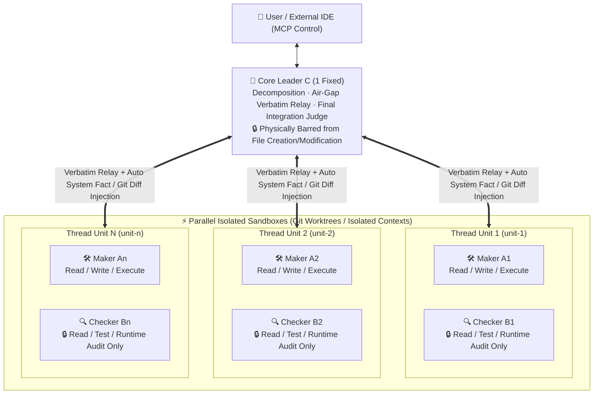

# 🧠 CKD Theory (Air-Gapped Triadic Verification & Closed-Loop Knowledge Distillation)

<p align="center">
  <strong>Physical Separation of Powers, Air-Gapped Verbatim Relay, and Three-Party Unanimous Convergence for Zero-Hallucination AI Systems and Self-Verifying Small Language Models (SLMs)</strong><br>
  <em>Originated & Architected by <a href="https://axnli.com">AXNli Inc.</a> (Systems for Data & AI)</em>
</p>

<p align="center">
  <a href="./README.md"></a>
  <a href="./README.ko.md"></a>
  <a href="https://axnli.com"></a>
  <a href="./LICENSE"></a>
</p>

---

> 🇰🇷 **한국어 원문 백서는 [README.ko.md](./README.ko.md)에서 확인하실 수 있습니다.**

---

## 1. Core Distinction & Epistemic Limits of Existing AI Agents

> [!IMPORTANT]
> **Clarification: CKD is NOT "multiple user chat threads inside a Claude/Gemini/ChatGPT project."**
> * Opening multiple chat threads in a standard AI workspace requires a **human user** to manually jump between tabs, copy-paste context, and manage separate conversations.
> * In **CKD Theory**, the user states their goal **once to a single fixed Core Leader (`C`)**. Inside the system, `C` autonomously spawns isolated Maker (`A_n`) and dedicated Checker (`B_n`) pairs (`[A1·B1], [A2·B2]...`), enforces cross-verification over system-extracted ground truth, and merges the verified output into one final result.

Existing AI agent architectures fall into two categories, and both suffer from structural epistemic bottlenecks:

1. **Limits of Single-Agent Harnesses (*SWE-agent, Aider, standard IDE agent loops*)**
   * A single session plans, edits code, runs tests, and judges its own completion (`Plan -> Edit -> Run -> Self-Check`).
   * **Structural Flaw 1 (Self-Confirmation Bias)**: Because the very same probability distribution (session) that introduced a bug also acts as its own reviewer, it rationalizes failures, weakens test assertions, and hallucinates that broken work is "complete."
   * **Structural Flaw 2 (Context Pollution)**: As trial-and-error logs accumulate inside one context window, attention over the original requirements and edge cases degrades rapidly.

2. **Limits of Chat-Room Multi-Agent Swarms (*AutoGen, CrewAI, role-play swarms*)**
   * Multiple agents given different role prompts ("Developer", "Reviewer", "Planner") talk directly to each other inside a shared group chat.
   * **Structural Flaw (Sycophantic Groupthink)**: When the Developer AI persuasively claims "I fixed the issue," the Reviewer AI sharing the same conversational flow agrees and rubber-stamps the work without independent ground-truth verification.

---

## 2. Paradigm Comparison: Single-Agent Harness vs. Chat-Room Multi-Agent vs. `CKD` Theory

Originated by **[AXNli Inc.](https://axnli.com)**, **`CKD` Theory** is not prompt role-play. It is a systems engineering architecture that enforces **physical separation of powers (runtime tool removal)**, **air-gapped verbatim relay**, and a **three-party unanimous convergence loop (`A · B · C`)**.

| Dimension | Single-Agent Harness (`SWE-agent`, etc.) | Chat-Room Multi-Agent (`AutoGen`, `CrewAI`) | **⚡ `CKD` Theory by AXNli Inc.** |
| :--- | :--- | :--- | :--- |
| **Role Topology** | 1 agent does everything | $N$ agents talk directly in one room | **`1 Fixed Core Leader (C)` + `$N$ Parallel [A_n · B_n] Pairs`** |
| **Isolation Rule** | Single-context self-talk | Direct communication (`A <-> B`) | **Strict Air-Gap**: `A_n` and `B_n` never talk directly; only `C` relays verbatim |
| **Tool Permission Boundary** | Monopolizes all tools | Restricted only by prompt text ("Do not edit") | **Physical Runtime Tool Removal**: `B_n` and `C` have file write/edit tools physically stripped |
| **Evidence Delivery** | Agent's own summary report | Claims posted as chat messages | **System Ground-Truth Injection**: System extracts actual `git diff` / raw outputs and attaches them to `B_n` via `C` |
| **Definition of `1 Round`** | 1 tool call or simple retry | 1 chat turn | **`[A_n ⇄ B_n inner ping-pong until both declare DONE]` + `[C's global integration verification]`** |
| **Completion Condition** | Agent unilaterally claims "Done" | Reviewer simply replies "LGTM" | **`A(DONE) + B(DONE) + C(PASS)` Three-Party Unanimous Declaration** (`Unlimited (0)` or `$N$ rounds`) |
| **Post-Task Artifact** | Discarded one-off logs | Discarded chat history | **Human-locked (`training_label`) role-separated dataset (`A.jsonl`, `B.jsonl`, `C.jsonl`, `curated.jsonl`)** |

---

## 3. The Four Formal Axioms of `CKD` Theory

### Axiom 1: Physical Separation of Powers (`C ≠ A ≠ B`)

CKD physically separates authority into three mutually exclusive branches: Executive Direction & Supreme Judgment (`C`), Isolated Implementation (`A`), and Independent Ground-Truth Audit (`B`).



* **`C` (1 Fixed Core Leader)**: The sole entity communicating with the user. `C` analyzes the user's natural-language request, chooses the execution mode (`split` divide-and-conquer or `compete` tournament), sizes the `[A_n·B_n]` pairs, relays messages verbatim between `A_n` and `B_n` with system-extracted facts, and performs final integration verification (`PASS` / `FAIL`). `C` is physically barred from modifying files.
* **`A1..An` (Dedicated Makers)**: Focus 100% on implementing and fixing their assigned unit scope inside an isolated workspace.
* **`B1..Bn` (Dedicated Checkers)**: Paired 1:1 with `A1..An`. Physically barred from modifying files; they audit the system-injected ground truth (`git diff`, test logs, API payloads) and declare `DONE` or `NEEDS_FIX`.

---

### Axiom 2: Two-Tier Convergence Loop (Strict Definition of `1 Round`) & Unanimous Completion

In CKD, raw inference speed is secondary to guaranteed convergence. Even smaller or slower local models converge to verified completeness through the two-tier loop:

```mermaid
sequenceDiagram
    autonumber
    participant C as 👑 Core Leader C (1 Fixed)
    participant A as 🛠️ Maker Thread A_n (Isolated)
    participant B as 🔍 Checker Thread B_n (Auditor)

    rect rgb(25, 33, 48)
    Note over C,B: 🔄 Start of CKD Round 1 (maxRounds=0 runs until unanimity, or fixed N rounds)
    C->>A: 1. Dispatch unit task and explicit completion criteria
    
    loop Inner Ping-Pong Loop (Repeats until BOTH A_n and B_n declare "DONE")
        A->>C: 2. Implement in isolated sandbox and report DONE
        C->>B: 3. Verbatim relay of A_n's report + system-extracted Git Diff / Ground Truth
        B->>C: 4. Audit actual files/tests/runtime and declare "NEEDS_FIX" or "DONE"
        opt Defect found by B_n (NEEDS_FIX)
            C->>A: 5. Relay B_n's exact findings back to A_n for repair (C diagnoses root cause on 3 consecutive loops)
        end
    end

    Note over A,B: ✅ Inner Loop Converged: A_n = DONE & B_n = DONE
    C->>C: 6. C inspects the merged whole across all units using read-only verification tools
    alt C detects integration defect (FAIL verdict)
        C->>A: 7a. [End of Round 1] Dispatch corrective instructions to A_n -> Start Round 2 inner ping-pong
    else C confirms full integrity (PASS verdict)
        Note over C,B: 🏆 A(DONE) + B(DONE) + C(PASS) Three-Party Unanimity -> Task COMPLETED!
    end
    end
```



1. **Inner Ping-Pong (`C -> A -> C -> B -> C -> A ...`)**:
   * `C` instructs `A` -> `C` relays `A`'s work + system facts to `B` -> `B` audits and declares **`NEEDS_FIX` or `DONE`** -> if `NEEDS_FIX`, `C` relays `B`'s critique back to `A` for repair.
   * This inner loop continues **until both `A` and `B` declare `DONE`**.
2. **Outer Global Integration Check (`= 1 Round`)**:
   * Once all `[A_n·B_n]` units reach `DONE`, **`C` verifies the combined result**. If `C` finds any integration issue (`FAIL`), it sends corrective instructions back to `A_n` to begin another inner ping-pong cycle. **This entire cycle (`[A ⇄ B until both DONE]` + `[C's global check]`) defines exactly `1 Round`.**
3. **Three-Party Unanimous Completion**:
   * A task finishes only when **`A(DONE) + B(DONE) + C(PASS)`** all concur.

---

### Axiom 3: Closed-Loop Knowledge Distillation

Every CKD execution acts as a structured data factory for continuous AI improvement:
* **Role-Separated Trajectories (`A.jsonl`, `B.jsonl`, `C.jsonl`)**: Captures pure implementation traces (`A`), strict audit traces (`B`), and decomposition/integration judgment traces (`C`).
* **Preference Pairs from `compete` Mode**: When multiple `[A_n·B_n]` pairs compete on the same problem, the winning unit (`preferred`) and runner-up (`non_preferred`) are recorded under the same prompt for Direct Preference Optimization (DPO).
* **Human Verdict Lock (`curated.jsonl`)**: Automated rule-based inspection flags anomalies, and human evaluation (`good` / `partial` / `bad`) permanently locks verified trajectories into `curated.jsonl` for local model fine-tuning.

---

### Axiom 4: Intra-Model CKD for Next-Generation Small Language Models (SLMs)

> **🔬 Ongoing Research & Development at AXNli Inc.**: *Building Self-Verifying Small AI Models via Intra-Model CKD*

While the CKD architecture powers multi-thread agent orchestrators (such as **Herdr CKD**), **its deeper theoretical potential lies in creating a new generation of compact, ultra-reliable Small Language Models (SLMs).**

Why does CKD make it possible to build small AI models that achieve frontier-grade reliability on targeted domains?

1. **Overcoming Small-Model Context Fragility via Cognitive Decomposition**:
   When a small model (1B to 3B parameters) is asked to plan, execute tools, and self-verify in one monolithic pass, its attention collapses. By embedding CKD's role separation (`C` for decomposition and final judgment, `A` for narrow execution, `B` for ground-truth verification), each inference step operates over a short, noise-free context window well within a small model's capacity.
2. **Eliminating Hallucinations Without Massive Parameter Scale**:
   Even if a compact `A` module has a 75% single-shot success rate on complex API or document tasks, coupling it with a dedicated `B` auditor that compares `A`'s output against deterministic system-injected facts (raw API JSON, schema validation, source text) catches and repairs errors internally before emitting the final answer.
3. **Internalizing the Triadic Loop into Compact Model Weights**:
   By distilling verified `A.jsonl`, `B.jsonl`, `C.jsonl`, and `compete` DPO trajectories generated by the CKD loop into compact role-specialized adapters or Mixture-of-Experts (MoE) routing layers, a single lightweight model can execute the `C -> A -> B -> C` deliberation cycle natively inside memory.

*AXNli Inc. is actively developing both open-source CKD orchestration software (**Herdr CKD**) and next-generation compact AI models built on Intra-Model CKD theory.*

---

## 4. Citation & Attribution

If you reference **CKD Theory** in academic work, technical articles, or software implementations, please cite:

```bibtex
@misc{axnli2026ckd,
  title  = {CKD Theory: Air-Gapped Triadic Verification and Closed-Loop Knowledge Distillation for AI Systems and Small Language Models},
  author = {AXNli Inc.},
  year   = {2026},
  url    = {https://axnli.com}
}
```

* **Originated by**: **[AXNli Inc. (`주식회사 에이엑스엔엘아이`)](https://axnli.com)**
* **License**: Apache-2.0 License (© 2026 AXNli Inc.)
